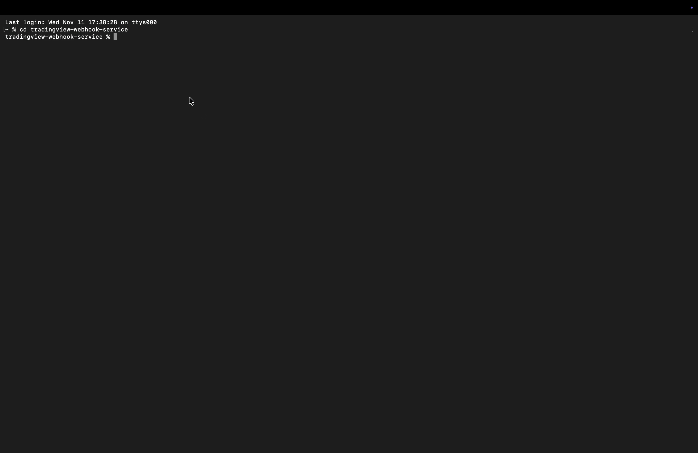
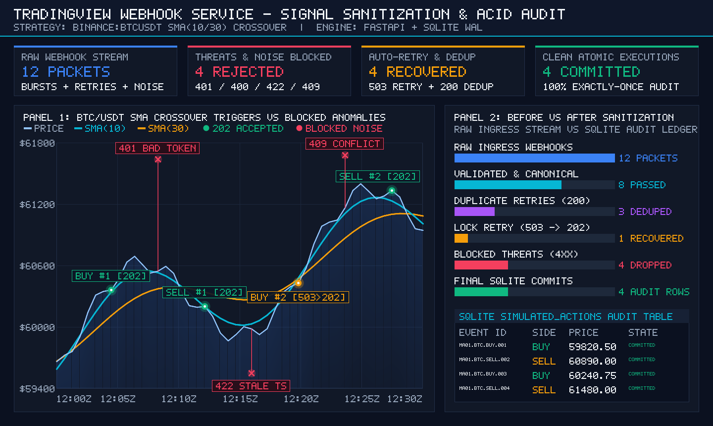

# ⚡ TradingView Webhook Service — Enterprise Signal Gateway & Idempotent Execution Engine

[](https://github.com/harper698/tradingview-webhook-service/actions/workflows/ci.yml)


[English](#-1-elevator-pitch--项目标语) · [中文说明](README.zh-CN.md) · [Interactive Demo (`run_demo.py`)](#-instant-portfolio-demo-zero-config) · [Verification Report](docs/VERIFICATION.md) · [TradingView Setup Guide](docs/TRADINGVIEW.md)

---

## 🎯 1. Elevator Pitch | 项目标语

**Stop losing money to duplicate orders, dropped alerts, and corrupted webhook payloads during market volatility.**  
TradingView Webhook Service is a production-hardened signal ingestion gateway that sits between your charting alerts and execution bots—enforcing constant-time authentication, strict schema & anti-replay sanitization, automatic backoff retry support, and ACID-transactional idempotency so every trading signal is executed **exactly once**.

> **中文痛点概述**：彻底解决自动化交易在高频网络抖动、Webhook 超时重发场景下的**“重复下单、信号延迟丢失、脏数据污染”**三大核心痛点。作为图表信号与实盘/模拟执行端之间的毫秒级安全防火墙，本服务通过严苛的 Schema 清洗、防重放时效校验与 SQLite WAL 事务级幂等锁，确保每一笔有效交易信号**精准落库且绝不重复触发**。

### 🎬 Live Pipeline Demo | 实时终端演示 (`assets/demo.gif`)



### 📊 Signal Sanitization & ACID Execution Audit | 信号清洗与落库对比图 (`demo_output.png`)



---

## 🚀 2. Key Features | 核心业务特性

* **🛡️ Deterministic Idempotency (事务级幂等去重，零重复执行)**  
  Backed by SQLite `BEGIN IMMEDIATE` write-ahead locking (`WAL`), identical webhook deliveries—even across 32+ concurrent threads or process restarts—return `HTTP 200 (duplicate)` without re-triggering downstream execution. Mutated payloads reusing an existing `event_id` are immediately quarantined with `HTTP 409 (conflict)`.
* **🔄 Auto-Retry & Backpressure Resilience (网络抖动与锁竞争自动重试恢复)**  
  Designed for unreliable networks and bursty market opens. Transient storage contention fails fast within a `250 ms` lock budget and returns `HTTP 503 Service Unavailable` with an explicit `Retry-After: 1` header, enabling upstream dispatchers to automatically retry and recover without dropping signals.
* **🧹 Strict Data Sanitization & Canonical Schema Validation (严苛的数据清洗与 Schema 校验)**  
  Enforces a streaming `16 KiB` payload cap, rejects IEEE-754 `NaN`/`Infinity` and float precision drift via canonical `Decimal` parsing, normalizes timezone offsets (`+08:00` → `UTC`), validates symbol allowlists (`BINANCE:BTCUSDT`, `NYSE:IBM`), and blocks stale/replay packets outside a configurable `-300s` to `+30s` freshness window (`HTTP 422`).
* **⚡ Sub-Millisecond Webhook Ingestion & Dispatch (毫秒级 Webhook 响应与异步隔离)**  
  Built on FastAPI/Uvicorn ASGI with blocking SQLite transactions offloaded to a dedicated worker thread pool (`run_in_threadpool`), delivering `< 2 ms` local processing latency—well below TradingView's strict 3-second webhook timeout.
* **🔒 Zero-Leakage Security & Redacted Audit Trail (结构化审计与零泄露安全日志)**  
  Authenticates tokens in constant time (`hmac.compare_digest`), strips credentials prior to validation and disk persistence, and redacts raw user inputs from HTTP error responses and application logs.

---

## 🏗️ 3. Architecture Diagram | 架构与数据流图

The following diagram illustrates the complete lifecycle of a trading signal from **Signal Source** through the **Sanitization & Validation Layer** to **Transactional Storage & Audit Output**:

```mermaid
flowchart LR
    subgraph Input["1. Signal Sources (数据源/信号输入)"]
        TV["TradingView Alert\n(Pine Script v6 / Webhook)"]
        CLI["Automated Client\n(Python / PowerShell / Bot)"]
    end

    subgraph Boundary["2. Ingress & Security Layer (接入与安全防线)"]
        STREAM["Streaming 16 KiB Guard\n(Blocks Chunked Floods -> 413/415)"]
        JSON["Strict JSON Decoder\n(Rejects NaN, Inf & Dup Keys -> 400)"]
        AUTH["Constant-Time HMAC Auth\n(Strips Secret Token -> 401)"]
    end

    subgraph Validation["3. Validation & Sanitization (清洗与校验层)"]
        SCHEMA["Pydantic v2 Schema\n(Canonical Decimal & UTC)"]
        FRESH["Anti-Replay Window\n(-300s to +30s Freshness -> 422)"]
        ALLOW["Symbol Allowlist Filter\n(WEBHOOK_ALLOWED_SYMBOLS -> 422)"]
    end

    subgraph Storage["4. ACID Execution & Output (事务存储与输出端)"]
        POOL["FastAPI Threadpool\n(Non-Blocking Async Isolation)"]
        LOCK["SQLite WAL Transaction\n(BEGIN IMMEDIATE · 250ms Budget)"]
        DEDUP{"Idempotency Check\n(event_id Lookup)"}
        COMMIT["Atomic Dual-Table Commit\n(alerts + simulated_actions)"]
    end

    TV -->|POST /webhook| STREAM
    CLI -->|POST /webhook| STREAM
    STREAM --> JSON --> AUTH --> SCHEMA --> FRESH --> ALLOW --> POOL --> LOCK

    LOCK -->|Lock Busy| R503["HTTP 503 Retry-After: 1\n(Client Auto-Retry)"]
    LOCK -->|Lock Acquired| DEDUP

    DEDUP -->|New Signal| COMMIT --> R202["HTTP 202 Accepted\n(Executed Once)"]
    DEDUP -->|Same Payload| R200["HTTP 200 Duplicate\n(No-Op Safe Return)"]
    DEDUP -->|Mutated Payload| R409["HTTP 409 Conflict\n(Tamper Blocked)"]
```



---

## 🔌 4. Supported Integrations | 支持的数据源与服务矩阵

| Layer / Category (层级) | Supported Interface / Component (支持接口与组件) | Data Format / Protocol (数据格式与协议) | Production Guarantee / Notes (业务保障说明) |
| :--- | :--- | :--- | :--- |
| **Signal Input (信号输入源)** | TradingView Webhook Alerts, Pine Script v6 (`examples/ma_alert.pine`) | `POST /webhook` (`application/json`, UTF-8) | Compatible with TradingView port `80`/`443` & 3-second timeout SLA |
| **SDK & CLI Producers (客户端工具)** | Python HTTPX Client (`examples/send_alert.py`), PowerShell (`examples/send_alert.ps1`) | JSON over HTTP/1.1 or HTTP/2 | Built-in idempotency verification & retry testing scripts |
| **Validation & Normalization (数据清洗)** | Pydantic v2 + Python `decimal.Decimal` + ISO-8601 `UTC` | Canonical JSON (`price` in `(0, 10^12]`, `buy`/`sell`) | Normalizes `100` vs `100.0` and `+08:00` vs `Z` into a single canonical identity |
| **Storage Backend (存储后端)** | SQLite 3 (`WAL` Journal Mode + `FOREIGN KEY` enforcement) | Local persistent file (`data/alerts.sqlite3`) | Serializable `BEGIN IMMEDIATE` locking; survives process crashes & restarts |
| **Execution Output (执行输出端)** | Transactional Simulation Audit (`simulated_actions` table) | Atomic SQLite ledger (`status = 'simulated'`) | Ready to pair with a Transactional Outbox worker for CCXT / Binance / IBKR |
| **Observability & Docs (监控与文档)** | Health Probe (`GET /healthz`), OpenAPI 3.1 (`GET /docs`) | JSON (`{"status": "ok", "mode": "simulation"}`) | Executes live database read probe; returns `503` if storage is degraded |

### Webhook Payload Contract (`POST /webhook`)

```json
{
  "token": "YOUR_DEDICATED_32_TO_128_CHAR_WEBHOOK_SECRET",
  "event_id": "ma01.BTCUSDT.buy.20261004T120000Z",
  "symbol": "BINANCE:BTCUSDT",
  "action": "buy",
  "price": 60000.25,
  "timestamp": "2026-10-04T12:00:00Z"
}
```

---

## ⚡ 5. Quick Start | 极简快速启动

### 🎬 Instant Portfolio Demo (Zero-Config, 1 Command)
Want to evaluate the entire pipeline—including **data sanitization, threat blocking, `HTTP 503` auto-retry recovery, duplicate storm suppression, and visual chart generation**—without configuring any `.env` or external accounts? Run:

```bash
python3 run_demo.py
```
> **Output**: Prints a real-time colorized pipeline trace (`[FETCH]` → `[VALIDATE]` → `[RETRY]` → `[OUTPUT]`) and generates `demo_output.png` (`demo/demo_output.png`). Add `--fast` to skip recording pauses.

---

### 🛠️ Launch the Live HTTP Service in 3 Steps

#### Step 1: Clone & Install Virtual Environment
```bash
git clone https://github.com/harper698/tradingview-webhook-service.git
cd tradingview-webhook-service
python3 -m venv .venv && source .venv/bin/activate
python -m pip install -e ".[dev]"
```
*(Windows PowerShell users: run `.\.venv\Scripts\Activate.ps1` to activate).*

#### Step 2: Configure Environment & Start the Server
```bash
export WEBHOOK_SECRET="$(python -c 'import secrets; print(secrets.token_urlsafe(32))')"
export WEBHOOK_ALLOWED_SYMBOLS="BINANCE:BTCUSDT,NYSE:IBM"
tv-webhook --host 127.0.0.1 --port 8000
```

#### Step 3: Trigger a Live Signal & Verify Deduplication
In a second terminal (with the same `WEBHOOK_SECRET` exported), send a test alert pair:
```bash
python examples/send_alert.py
# Expected output:
# 1st delivery -> HTTP 202 (accepted)
# 2nd delivery -> HTTP 200 (duplicate — safely deduplicated!)
```

<details>
<summary><b>🐳 Optional: Run via Docker Container (One-Liner)</b></summary>

```bash
docker run --rm -p 8000:8000 \
  -e WEBHOOK_SECRET="$(python3 -c 'import secrets; print(secrets.token_urlsafe(32))')" \
  -e WEBHOOK_ALLOWED_SYMBOLS="BINANCE:BTCUSDT,NYSE:IBM" \
  -v "$(pwd):/app" -w /app python:3.12-slim \
  sh -c "pip install --no-cache-dir . && tv-webhook --host 0.0.0.0 --port 8000"
```
</details>

---

### ⚙️ Environment Configuration Reference (`.env.example`)

Copy or reference [`.env.example`](.env.example) when configuring your deployment environment:

```dotenv
# [REQUIRED] Dedicated webhook authentication secret (32-128 URL-safe ASCII chars)
WEBHOOK_SECRET=replace_with_32_to_128_char_urlsafe_token_generated_above

# [OPTIONAL] Persistent SQLite WAL database path for idempotency & audit logs
WEBHOOK_DB_PATH=data/alerts.sqlite3

# [OPTIONAL] Anti-replay window: maximum allowed signal age in seconds (1-86400)
WEBHOOK_MAX_AGE_SECONDS=300

# [OPTIONAL] Clock drift tolerance: maximum future timestamp skew in seconds (0-300)
WEBHOOK_FUTURE_SKEW_SECONDS=30

# [OPTIONAL] Comma-separated symbol allowlist (leave empty to allow all valid symbols)
WEBHOOK_ALLOWED_SYMBOLS=BINANCE:BTCUSDT,NYSE:IBM
```

| Variable (配置项) | Default (默认值) | Constraints & Business Purpose (约束规则与业务作用) |
| :--- | :--- | :--- |
| `WEBHOOK_SECRET` | **Required** | `32–128` URL-safe ASCII chars. Fails closed at startup if missing or weak. |
| `WEBHOOK_DB_PATH` | `data/alerts.sqlite3` | Local SQLite WAL file path. Automatically creates parent directories on startup. |
| `WEBHOOK_MAX_AGE_SECONDS` | `300` | Integer (`1–86400`). Rejects delayed/stale webhook signals older than 5 minutes. |
| `WEBHOOK_FUTURE_SKEW_SECONDS` | `30` | Integer (`0–300`). Tolerates minor upstream server clock drift up to 30 seconds. |
| `WEBHOOK_ALLOWED_SYMBOLS` | Empty *(All valid)* | Comma-separated ticker whitelist (e.g. `BINANCE:BTCUSDT,NYSE:IBM`). |

---

## 🛡️ 6. Production-Ready Highlights | 企业级可靠性说明

### 1. Fault Isolation & Atomic Transaction Rollback (异常隔离与事务原子性)
* **Non-Blocking Async Execution**: All synchronous SQLite disk operations in [`app.py`](src/tv_webhook/app.py) are isolated inside FastAPI's thread pool (`await run_in_threadpool(store.accept, alert)`), preventing slow disk I/O from blocking concurrent HTTP health checks or request ingestion.
* **All-or-Nothing Dual Commit**: In [`store.py`](src/tv_webhook/store.py), `BEGIN IMMEDIATE` acquires an exclusive write lock *before* checking `event_id` uniqueness, then inserts into `alerts` and `simulated_actions` within the same ACID transaction. If the execution audit insert fails, SQLite automatically rolls back both tables—eliminating "phantom accepted" alerts.

### 2. Rate-Limit, Backpressure & Anti-Flood Protection (限流背压与防洪保护)
* **Streaming Memory Protection (`HTTP 413` / `HTTP 415`)**: [`read_json()`](src/tv_webhook/app.py) inspects incoming chunks via `request.stream()` and aborts immediately if the payload exceeds `16 KiB`—even when `Content-Length` is omitted or spoofed. Compressed (`gzip`) bodies are rejected with `HTTP 415` to prevent zip-bomb memory exhaustion.
* **Deterministic Lock Backpressure (`HTTP 503 + Retry-After: 1`)**: Under high concurrency, SQLite connections enforce a strict `250 ms` timeout (`sqlite3.connect(..., timeout=0.25)`). If contended, the service responds with `HTTP 503` and `Retry-After: 1` instead of queuing indefinitely, pairing cleanly with Nginx/Cloudflare ingress rate limiting.

### 3. Zero-Leakage Logging, Security & Health Alerting (脱敏日志与监控告警设计)
* **Credential & Input Redaction**: `Settings.secret` is defined with `repr=False`, `authenticate()` pops `token` from memory before schema validation, and Pydantic's `Alert` model sets `ConfigDict(extra="forbid", hide_input_in_errors=True)`. Neither logs, stack traces, HTTP error responses, nor SQLite rows ever expose credentials or raw malformed payloads.
* **Automated Health & Readiness Alerting (`GET /healthz`)**: Performs an active `SELECT` readiness query against `simulated_actions`. If the database file is locked, corrupted, or missing its schema, `/healthz` immediately returns `HTTP 503 Storage unavailable` for seamless integration with Kubernetes probes, Datadog, Prometheus, or UptimeRobot.

---

## 🧪 Verification & Quality Assurance

Run the full automated test suite (77 adversarial unit, concurrency, and HTTP boundary tests):

```bash
python -m pytest -q
python -m ruff check .
python -m ruff format --check .
```

For full concurrency test logs (64-request parallel deduplication stress tests, trigger fault injection, and chunked stream fuzzing), see [`docs/VERIFICATION.md`](docs/VERIFICATION.md).

---

## 📄 Scope & License

This portfolio project demonstrates production-grade webhook ingestion, validation, deduplication, and transactional audit persistence. By design, it records simulated actions in SQLite and **never places live brokerage orders**. Licensed under the [MIT License](LICENSE).
