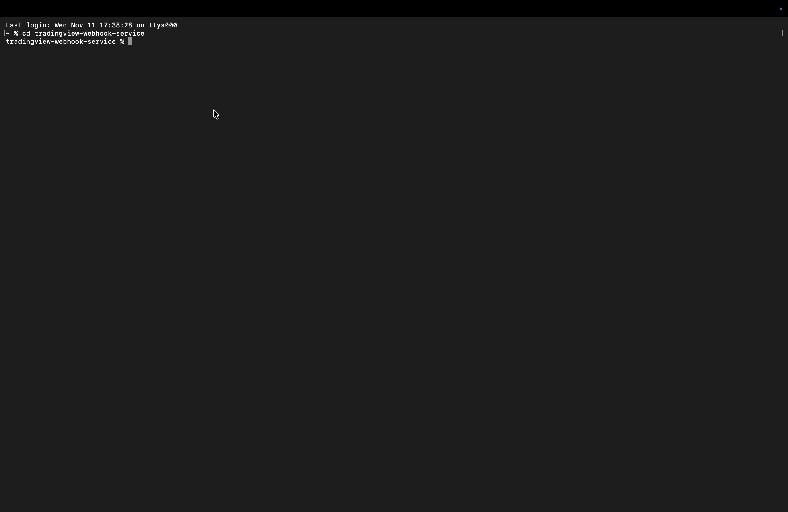
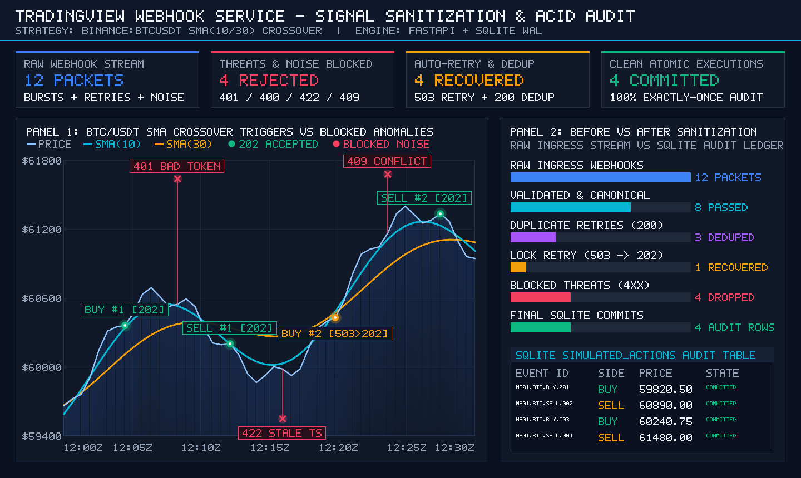

# ⚡ TradingView Webhook 商业级高可靠信号网关与幂等执行引擎

[](https://github.com/harper698/tradingview-webhook-service/actions/workflows/ci.yml)


[English Product Page](README.md) · [一键交互式演示 (`run_demo.py`)](#-极简快速启动-quick-start) · [验证记录](docs/VERIFICATION.md) · [TradingView 配置指南](docs/TRADINGVIEW.md)

---

## 🎯 1. 项目标语（Elevator Pitch）

**彻底解决自动化交易在高频网络抖动、Webhook 超时重发下的“重复下单、信号延迟丢失、脏数据污染”三大业务痛点。**  
本系统作为 TradingView 图表警报与交易执行后端之间的毫秒级安全防火墙，内置常量时间认证、严苛的 Schema 清洗、防重放时效窗口、503 自动重试背压恢复与 SQLite WAL 事务级幂等锁，确保每一笔有效信号**精准落库且绝不重复执行**。

### 🎬 实时运行演示（Live Pipeline Demo）



### 📊 信号清洗与落库对比图（Signal Sanitization & Audit Report）



---

## 🚀 2. 核心业务特性（Key Features）

* **🛡️ 事务级强幂等去重（Zero-Duplicate Idempotency）**  
  基于 SQLite `BEGIN IMMEDIATE` 写锁与 `WAL` 模式，按 `event_id` 严格序列化校验。无论是上游重试风暴、32+ 线程高并发请求还是服务进程重启，重复信号均安全返回 `HTTP 200 (duplicate)`；同 ID 篡改载荷则立即拦截并返回 `HTTP 409 (conflict)`。
* **🔄 网络抖动与锁竞争自动重试恢复（Auto-Retry & Backpressure Recovery）**  
  内置 `250 ms` 锁超时预算。当高频突发流量引发瞬时写锁竞争时，系统快速返回 `HTTP 503 Service Unavailable` 并携带 `Retry-After: 1` 响应头，引导客户端自动退避重试，避免连接挂起或丢单。
* **🧹 严苛的数据清洗与 Schema 校验（Data Sanitization & Schema Validation）**  
  流式限制 `16 KiB` 请求体上限，采用 `Decimal` 精确十进制归一化价格（拒绝 `NaN`、`Infinity`、浮点精度漂移与字符串数字），自动将不同时区（如 `+08:00`）统一转换为标准 `UTC`，支持交易品种白名单过滤，并拦截超出 `-300s ~ +30s` 窗口的过期重放信号（`HTTP 422`）。
* **⚡ 毫秒级 Webhook 接收与转发（Millisecond-Level Ingestion）**  
  采用 FastAPI 异步边界 + 独立线程池隔离磁盘 I/O（`run_in_threadpool`），本地处理延迟 `< 2 ms`，远低于 TradingView 官方 3 秒超时阈值。
* **🔒 零泄露安全审计与脱敏日志（Zero-Leakage Structured Audit）**  
  使用 `hmac.compare_digest` 防止时序攻击，认证通过后立即从内存中剔除 `token`；应用日志、异常堆栈、HTTP 报错响应与数据库记录中均绝不打印或留存任何密钥及原始脏输入。

---

## 🏗️ 3. 架构与数据流图（Architecture Diagram）

```mermaid
flowchart LR
    subgraph Input["1. 信号输入源 (Signal Sources)"]
        TV["TradingView 图表警报\n(Pine Script v6 / Webhook)"]
        CLI["自动化测试/上游客户端\n(Python / PowerShell)"]
    end

    subgraph Boundary["2. 接入与安全防线 (Ingress & Security)"]
        STREAM["16 KiB 流式请求体守卫\n(拦截超大/压缩包 -> 413/415)"]
        JSON["严格 JSON 解析器\n(拒绝 NaN/Inf/重复键 -> 400)"]
        AUTH["HMAC 常量时间令牌校验\n(剥离 Token 密钥 -> 401)"]
    end

    subgraph Validation["3. 清洗与校验层 (Validation Layer)"]
        SCHEMA["Pydantic v2 Schema 校验\n(Decimal 价格 & UTC 归一化)"]
        FRESH["防重放时效窗口校验\n(-300s 至 +30s -> 422)"]
        ALLOW["交易品种白名单过滤\n(WEBHOOK_ALLOWED_SYMBOLS -> 422)"]
    end

    subgraph Storage["4. 事务存储与输出端 (ACID Storage & Output)"]
        POOL["FastAPI 异步线程池隔离\n(run_in_threadpool)"]
        LOCK["SQLite WAL 独占写事务\n(BEGIN IMMEDIATE · 250ms 预算)"]
        DEDUP{"event_id 幂等判重"}
        COMMIT["双表原子提交\n(alerts + simulated_actions)"]
    end

    TV -->|POST /webhook| STREAM
    CLI -->|POST /webhook| STREAM
    STREAM --> JSON --> AUTH --> SCHEMA --> FRESH --> ALLOW --> POOL --> LOCK

    LOCK -->|瞬时锁忙| R503["HTTP 503 Retry-After: 1\n(触发上游自动退避重试)"]
    LOCK -->|获取写锁| DEDUP

    DEDUP -->|全新有效信号| COMMIT --> R202["HTTP 202 Accepted\n(唯一落库与执行)"]
    DEDUP -->|完全相同载荷| R200["HTTP 200 Duplicate\n(安全幂等跳过)"]
    DEDUP -->|同 ID 篡改载荷| R409["HTTP 409 Conflict\n(拦截异常冲突)"]
```



---

## 🔌 4. 支持的数据源/服务矩阵（Supported Integrations）

| 模块层级 | 支持的接口 / 服务组件 | 数据格式与协议规范 | 商业交付保障说明 |
| :--- | :--- | :--- | :--- |
| **数据源 / 信号输入** | TradingView Webhook 警报、Pine Script v6 (`examples/ma_alert.pine`) | `POST /webhook` (`application/json`, UTF-8) | 满足 TradingView 80/443 端口要求及 3 秒超时限制 |
| **客户端 / 调试工具** | Python 客户端 (`examples/send_alert.py`)、PowerShell (`examples/send_alert.ps1`) | HTTP/1.1 & HTTP/2 JSON | 开箱即用的首次投递 + 重复投递自动化验证脚本 |
| **数据清洗 / 规范化** | Pydantic v2 + `decimal.Decimal` + ISO-8601 `UTC` | 规范化 JSON（`price` 范围 `(0, 10^12]`，`buy`/`sell`） | 自动将 `100` 与 `100.0`、`+08:00` 与 `Z` 识别为同一规范化信号 |
| **持久化存储后端** | SQLite 3（`WAL` 预写日志模式 + 外键约束） | 本地持久化数据库 (`data/alerts.sqlite3`) | `BEGIN IMMEDIATE` 强序列化事务，跨进程重启不丢失去重状态 |
| **输出端 / 执行审计** | 事务级模拟执行审计表 (`simulated_actions`) | 原子写入记录 (`status = 'simulated'`) | 可无缝扩展对接 Transactional Outbox 异步发件箱及实盘券商接口 |
| **健康检查 / 接口文档** | 就绪探针 (`GET /healthz`)、OpenAPI 3.1 (`GET /docs`) | JSON (`{"status": "ok", "mode": "simulation"}`) | 实时执行数据库读取自检，异常时返回 `503` 供监控系统告警 |

---

## ⚡ 5. 极简快速启动（Quick Start）

### 🎬 方式 A：零配置一键运行演示脚本（推荐直接体验或录制 GIF）
无需配置任何 API Key 或 `.env`，内置沙盒数据流生成器与可视化报表引擎，一键运行：

```bash
python3 run_demo.py
```
> 运行后将在控制台动态打印 `[FETCH]` → `[VALIDATE]` → `[RETRY]` → `[OUTPUT]` 全流程，并自动生成高清对比图表 `demo_output.png`（及 `demo/demo_output.png`）。附加 `--fast` 参数可跳过录屏停顿。

---

### 🛠️ 方式 B：3 步启动标准 HTTP 服务

#### 第 1 步：创建虚拟环境并安装依赖
```bash
python3 -m venv .venv && source .venv/bin/activate
python -m pip install -e ".[dev]"
```

#### 第 2 步：注入安全密钥并启动服务
```bash
export WEBHOOK_SECRET="$(python -c 'import secrets; print(secrets.token_urlsafe(32))')"
export WEBHOOK_ALLOWED_SYMBOLS="BINANCE:BTCUSDT,NYSE:IBM"
tv-webhook --host 127.0.0.1 --port 8000
```

#### 第 3 步：发送测试信号验证幂等去重
在第二个终端（导出相同的 `WEBHOOK_SECRET`）执行：
```bash
python examples/send_alert.py
# 预期输出：第 1 次请求返回 202 accepted，第 2 次相同请求返回 200 duplicate
```

---

### ⚙️ `.env.example` 配置说明

参考项目根目录下的 [`.env.example`](.env.example)：

| 环境变量 | 默认值 | 校验规则与业务用途 |
| :--- | :--- | :--- |
| `WEBHOOK_SECRET` | **必填** | `32–128` 位 URL 安全 ASCII 字符；缺失或强度不足时服务拒绝启动（Fail-Closed） |
| `WEBHOOK_DB_PATH` | `data/alerts.sqlite3` | SQLite WAL 数据库存储路径，启动时自动创建父级目录 |
| `WEBHOOK_MAX_AGE_SECONDS` | `300` | 整数 (`1–86400`)；允许的最大信号延迟秒数，拦截超时重放信号 |
| `WEBHOOK_FUTURE_SKEW_SECONDS` | `30` | 整数 (`0–300`)；允许的未来时钟偏移秒数，容忍轻微服务器时钟误差 |
| `WEBHOOK_ALLOWED_SYMBOLS` | 空 *(允许所有合规品种)* | 逗号分隔的交易对白名单（如 `BINANCE:BTCUSDT,NYSE:IBM`） |

---

## 🛡️ 6. 企业级可靠性说明（Production-Ready Highlights）

1. **异常隔离与原子回滚（Fault Isolation & Atomic Rollback）**  
   在 [`app.py`](src/tv_webhook/app.py) 中，所有 SQLite 磁盘写入均通过 `run_in_threadpool` 在独立工作线程中执行，绝不阻塞 FastAPI 异步事件循环；在 [`store.py`](src/tv_webhook/store.py) 中，`alerts` 与 `simulated_actions` 处于同一 `BEGIN IMMEDIATE` 事务内，任何一步发生异常均整体回滚，杜绝“警报已收但指令未落库”的脏状态。
2. **Rate-Limit 限流背压与防洪保护（Backpressure & Flood Defense）**  
   [`read_json()`](src/tv_webhook/app.py) 采用流式分块读取（`request.stream()`），一旦请求体积超过 `16 KiB` 立即中断并返回 `HTTP 413`，无需信任可能被伪造的 `Content-Length`；拒绝压缩请求体（`HTTP 415`）防范解压炸弹；遇到高并发写锁竞争时在 `250 ms` 内快速返回 `HTTP 503` 及 `Retry-After: 1`，配合反向代理（Nginx/Cloudflare）限流策略实现平滑削峰。
3. **脱敏日志与监控告警设计（Redacted Logging & Health Alerting）**  
   `Settings.secret` 配置 `repr=False`，Pydantic 模型开启 `hide_input_in_errors=True`，数据库异常日志仅输出结构化事件（`Storage operation failed`），绝不泄露 Token、SQL 语句或用户原始报文。内置 `GET /healthz` 探针实时校验数据库表可用性，异常时返回 `503` 以触发生产监控告警。
